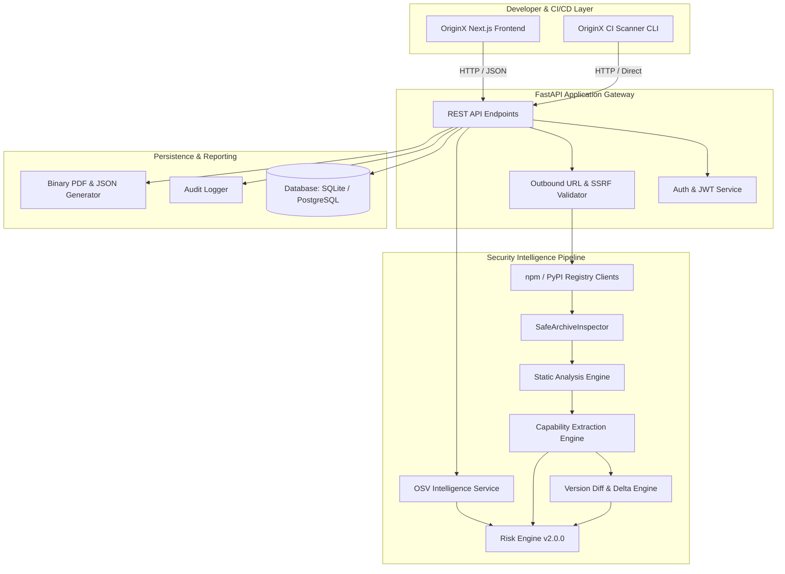

# OriginX

### Know What Goes Into Your Software.

OriginX is a software supply-chain security intelligence platform designed to identify vulnerabilities, analyse package behaviour, detect suspicious capabilities, verify package integrity and assess dependency risks before software reaches production.

---

## 1. Problem Statement

Modern software applications are built by assembling hundreds of third-party open-source dependencies from registries such as **npm** and **PyPI**. Traditional software composition analysis (SCA) tools only check known CVE databases. 

However, emerging software supply-chain attacks — including account takeovers, dependency confusion, typosquatting, malicious installation hooks, second-stage remote code droppers, and credential harvesting scripts — often execute and exfiltrate secrets **before** any public CVE advisory is published.

**OriginX solves this gap** by combining:
1. Real-time vulnerability intelligence (OSV / GHSA).
2. Deep static code analysis and token-based capability extraction.
3. Differential release comparisons (AST, capability delta, file modifications).
4. Out-of-band behavioral evidence correlation.
5. Explainable, multi-factor risk scoring and automated gatekeeping.

---

## 2. Core Features

- **Package Scanner (On-Demand Deep Scan)**:
  - Fetches package tarballs directly from npm and PyPI over secure channels.
  - Safe archive inspection enforcing strict size, file count, symlink, and path-traversal safeguards.
  - Extracts static code capabilities across JavaScript, TypeScript, and Python.

- **Vulnerability Intelligence (OSV Service)**:
  - Live querying of the Open Source Vulnerabilities (OSV) database.
  - Full CVSS v3.1 vector parsing with base score calculations.

- **Version Comparison & Capability Delta Engine**:
  - Compares two package releases side-by-side.
  - Tracks files added, removed, and modified.
  - Performs release-to-release capability delta extraction to flag newly introduced capabilities (e.g. newly introduced outbound network calls or process spawns).

- **Multi-Factor Risk Engine (v2.0.0)**:
  - Explainable 0–100 risk scoring with transparent factor breakdown.
  - Dynamic policy evaluation yielding actionable outcomes: `ALLOW`, `REVIEW`, or `BLOCK`.
  - Evidence correlation engine that identifies multi-signal threat patterns (e.g., credential reading correlated with outbound network requests).

- **Project Management & Manifest Auditing**:
  - Parse `package.json`, `package-lock.json`, and `requirements.txt` manifests.
  - Audit unpinned version ranges and typosquatting risk signals.

- **Automated CI/CD Scanner & Gate**:
  - Headless CLI scanner (`python -m app.cli.ci_scanner`) for pull requests and pipelines.
  - Emits machine-readable `originx-report.json` and configurable pipeline exit codes.

- **Enterprise Governance & Reports**:
  - Database-backed security policies with granular toggle controls.
  - Tamper-evident audit trail capturing every scan, project change, and report generation event.
  - Native binary `%PDF-1.4` and structured JSON report generation.
  - Standard library PBKDF2-HMAC-SHA256 user authentication and HMAC-SHA256 signed JWT tokens.

---

## 3. Technology Stack

### Backend
- **Framework**: Python 3.13 / FastAPI (Asynchronous ASGI)
- **Database Layer**: SQLAlchemy 2.0 with Async Engine (SQLite for dev/testing, PostgreSQL `asyncpg` compatible for production)
- **HTTP Client**: HTTPX (Asynchronous with connection pooling and DNS-level SSRF validation)
- **Security Primitives**: Zero third-party C dependencies; Python standard library `hashlib`, `hmac`, `secrets`, `base64`

### Frontend
- **Framework**: Next.js 16.4.6 (App Router with Turbopack)
- **UI Library**: React 19, TypeScript
- **Styling**: Tailwind CSS & Modern Custom CSS Variables (Midnight Navy `#0A0F1D` & Electric Cyan `#06B6D4`)
- **Icons**: Lucide React

---

## 4. System Architecture



---

## 5. Getting Started & Installation

### Prerequisites
- Python 3.13+ installed
- Node.js 18+ and npm installed

### 1. Clone & Setup Configuration
```bash
git clone https://github.com/your-org/originx.git
cd originx

# Create backend environment file
cp backend/.env.example backend/.env
```

### 2. Backend Setup
```bash
# Navigate to backend directory or use root with PYTHONPATH
cd backend
python -m venv venv

# On Windows:
.\venv\Scripts\activate
# On Linux/macOS:
source venv/bin/activate

pip install -r requirements.txt
```

Start the backend API server:
```bash
python -m uvicorn app.main:app --host 127.0.0.1 --port 8000 --reload
```
API Documentation will be available at: `http://127.0.0.1:8000/docs`

### 3. Frontend Setup
Open a new terminal session:
```bash
cd frontend
npm install
npm run dev
```
The OriginX dashboard will be accessible at: `http://localhost:3000`

---

## 6. Running Tests & Quality Verification

### Run Automated Backend Test Suite
```bash
# From repository root with backend on PYTHONPATH
set PYTHONPATH=backend;backend/venv/Lib/site-packages
python -m pytest backend/tests
```
*Current test suite: 52 automated tests covering static analysis, capability extraction, OSV parsing, SSRF boundaries, password hashing, and report generation.*

### Run Frontend Production Build
```bash
npm run build --prefix frontend
```

### Run CI Scanner CLI Locally
```bash
python -m app.cli.ci_scanner --manifest package.json --policy-fail BLOCK
```

---

## 7. Security Architecture & Controls

- **SSRF & Outbound Request Defense**: All external registry queries and download URLs pass through `validate_outbound_url`. Enforces domain whitelisting, resolves DNS, and blocks all internal (`10.0.0.0/8`, `172.16.0.0/12`, `192.168.0.0/16`), loopback (`127.0.0.1`), and cloud metadata (`169.254.169.254`) targets.
- **Safe Archive Inspection**: Unpacks archives strictly in-memory using `io.BytesIO` and Python standard library `tarfile`/`zipfile`. Enforces 25 MB max compressed upload, 60 MB uncompressed cap, 5,000 max file extraction, and blocks directory traversal (`../`) and absolute symlinks.
- **Zero Package Code Execution**: OriginX never runs `npm install`, `setup.py`, or package scripts. Inspection is performed via non-executing AST parsers and regex analysis.
- **Cryptographic Independence**: Authentication uses PBKDF2-HMAC-SHA256 (100,000 iterations) and standard library HMAC-SHA256 signed JWTs with zero external C-extensions.

---

## 8. Deployment Architecture Recommendation

- **Backend**: Containerize with Docker, deploy to AWS ECS Fargate, Google Cloud Run, or Render. Run with `uvicorn app.main:app --workers 4`.
- **Database**: Managed PostgreSQL instance (e.g. AWS RDS or Supabase/Neon Serverless) with `DATABASE_URL="postgresql+asyncpg://..."`.
- **Frontend**: Deploy Next.js to Vercel or AWS Amplify with `NEXT_PUBLIC_API_URL` configured.

---

## 9. Known Limitations

- Dynamic behavior occurring exclusively inside obfuscated encrypted payloads (C2 communication) requires active sandboxing or runtime eBPF monitoring, which is outside the scope of static inspection.
- Private npm/PyPI enterprise registries require configuring custom domain allowlists in `ALLOWED_REGISTRY_DOMAINS`.

---

## 10. License

OriginX is open-source software licensed under the [MIT License](LICENSE).
